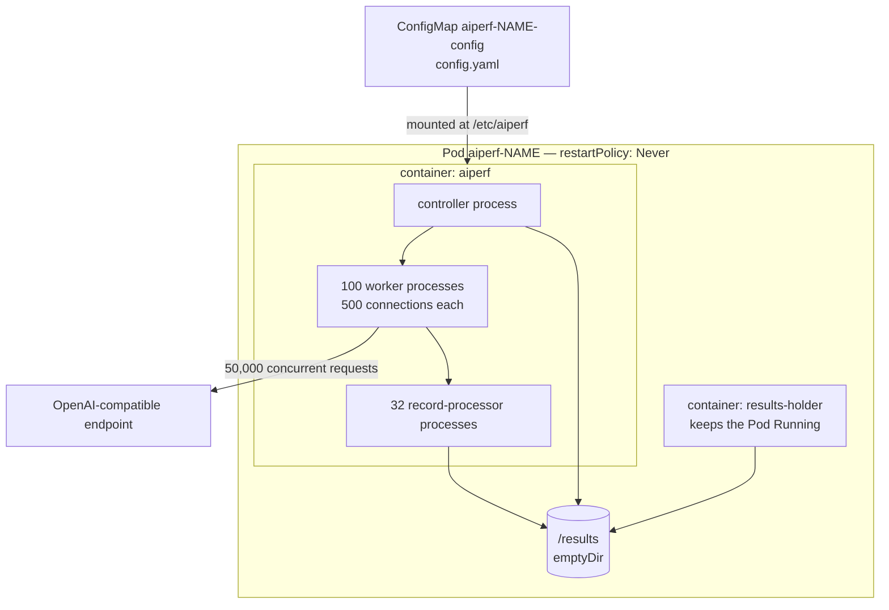

# Bare Pod Mode

Bare Pod mode runs an entire AIPerf benchmark inside a single Kubernetes
`kind: Pod`. `aiperf kube generate --bare-pod` and `aiperf kube profile
--bare-pod` render one `ConfigMap` plus one `Pod`, apply them directly to the
API server, and run `aiperf profile --config /etc/aiperf/config.yaml` in
multiprocessing mode. There is no operator, no `AIPerfJob` custom resource, no
`JobSet`, and no CRD probe.

The controller, every worker, and every record processor are child processes of
the one container, not separate containers or Pods. That single-container,
single-network-namespace shape is what a single node can offer, which makes it
the right deployment for the official SemiAnalysis AgentX harness workload at
50,000 concurrency — and the direct equivalent of a single Slurm node.

Use bare Pod mode when:

- The benchmark must fit on one node (for example, a 50,000-concurrency AgentX
  run whose connection budget is bounded by one network namespace).
- You cannot or do not want to install the AIPerf operator or JobSet.
- You want a manifest that maps one-to-one onto a Slurm `srun --nodes=1` step.

For multi-node or multi-Pod runs, use the [operator or direct mode](direct-mode.md)
instead; bare Pod mode does not scale across Pods.

---

## What it renders

`--bare-pod` emits two documents, in creation order:

| Resource | Name | Contents |
|---|---|---|
| `ConfigMap` | `aiperf-<name>-config` | The resolved `AIPerfConfig` as `config.yaml` |
| `Pod` | `aiperf-<name>` | The `aiperf` benchmark container plus a `results-holder` sidecar |

The Pod has `restartPolicy: Never` and runs:

```yaml
command: ["aiperf"]
args: ["profile", "--config", "/etc/aiperf/config.yaml"]
```

It mounts five volumes:

- `config` — the `ConfigMap`, read-only at `/etc/aiperf`
- `results` — an `emptyDir` at `/results`
- `tmp` — an `emptyDir` at `/tmp`
- `tokenizer-cache` — an `emptyDir` at `/tmp/hf`, with `HF_HOME=/tmp/hf`
- `remote-cache` — an `emptyDir` at `/aiperf/remote-cache`, with
  `AIPERF_DATASET_REMOTE_CACHE_DIR` pointing at it

The container runs as non-root with a read-only root filesystem and all
capabilities dropped. `/tmp`, `/tmp/hf`, `/aiperf/remote-cache`, and `/results`
are the writable paths. The cross-run mmap dataset cache is disabled
(`AIPERF_DATASET_MMAP_CACHE_ENABLED=false`) because its default location is on
the read-only root filesystem.

A second container, `results-holder`, keeps the Pod alive after the benchmark
container exits so `/results` remains reachable by `kubectl cp`. It runs no
work and requests 10m CPU / 32Mi memory.

The rendered config rewrites the benchmark runtime for a single container:
`service_run_type` becomes `multiprocessing`, the UI is disabled, and the
cross-Pod controller addresses, API host/port, and per-Pod worker fields are
removed. That is why the Pod runs the ordinary `aiperf profile` stack rather
than the Kubernetes service topology.

### Topology



---

## Topology and worker math

The renderer resolves the process topology from the benchmark config:

- **Workers.** `--total-workers` sets the worker-process count. It is clamped
  to the peak phase concurrency, because more workers than in-flight slots
  cannot increase throughput. A `benchmark.runtime.workers` value in an
  authored YAML config also supplies the count.
- **Connections per worker.** `ceil(peak_concurrency / workers)`. At 50,000
  concurrency and 100 workers that is 500 connections per worker.
- **Record processors.** `ceil(workers / AIPERF_RECORD_PROCESSOR_SCALE_FACTOR)`,
  where the scale factor defaults to 4, floored at 32 once the Pod has at
  least 32 workers. At 100 workers that is 32 record processors. An explicit
  `benchmark.runtime.record_processors` overrides the derivation.
- **Connector limit.** Each worker's HTTP connector is raised to
  `AIPERF_HTTP_CONNECTION_LIMIT=65000` inside the Pod. The
  `ceil(concurrency / workers)` ratio is a planning estimate, not a runtime
  cap: AgentX subagent fanout can put more requests in flight than
  `--concurrency`, and the Pod must be allowed to open those extra
  connections rather than queue them behind the 2,500 default.

---

## Ephemeral port budget

Every concurrent outbound connection consumes one ephemeral source port in the
Pod's network namespace. Linux's default `net.ipv4.ip_local_port_range` is
`32768 60999` on most distributions — 28,232 ports, fewer than the 50,000 an
AgentX run needs. The renderer therefore sets the sysctl on the Pod's
`securityContext.sysctls`:

```yaml
securityContext:
  sysctls:
    - name: net.ipv4.ip_local_port_range
      value: "1024 65535"
```

Kubernetes treats `net.ipv4.ip_local_port_range` as a *safe* sysctl, so no
privileged init container is required.

The Pod always claims the whole `1024 65535` range: 64,512 ports. It is not
sized to the nominal `--concurrency`, because AgentX subagent fanout can put
more requests in flight than there are lanes, and an exactly-sized range would
strand those extra connections. The hard ceiling is therefore **64,512
simultaneous outbound sockets** per Pod; a nominal concurrency above that is
rejected with an error telling you to split the run across Pods or lower
`--concurrency`.

A user-authored `podTemplate.podSecurityContext.sysctls` entry for
`net.ipv4.ip_local_port_range` is honored only when it is at least as large as
the run requires. A smaller authored range is rejected rather than silently
replaced, because accepting it would fail mid-run with `EADDRNOTAVAIL` and no
indication of the cause.

At 50,000 connections, a node's `nf_conntrack_max` may also need raising; that
is a node-level setting outside the Pod spec.

---

## Sizing

The container request is derived from the shared memory estimator:

- **Memory** — the worker-Pod estimate plus a fixed 8 GiB controller reserve,
  rounded up to whole GiB. The controller reserve covers the whole run's
  metric-array bookkeeping; charging the full controller estimate verbatim
  would make the Pod unschedulable on any real node.
- **CPU** — `max(4, ceil(workers / 4))`. This is a coarse I/O-bound allowance,
  floored at 4 cores so the controller is not starved.

`spec.resourceMode` controls what is emitted: `burstable` (the default) writes
requests only, `guaranteed` writes requests equal to limits, and `none` omits
resources entirely.

The exact request depends on the dataset and context lengths. The table below
uses the AgentX scenario (`--scenario agentx` with
`--public-dataset semianalysis_cc_traces_weka_with_subagents`), which is what
the 50,000-concurrency workload uses:

| Peak concurrency | Workers | Conn/worker | Record processors | Ephemeral range | CPU request | Memory request |
|---:|---:|---:|---:|---|---:|---:|
| 10,000 | 20 | 500 | 5 | `1024 65535` | 5 | 15 GiB |
| 25,000 | 50 | 500 | 32 | `1024 65535` | 13 | 30 GiB |
| 50,000 | 100 | 500 | 32 | `1024 65535` | 25 | 41 GiB |

A shorter-context synthetic workload at the same concurrency sizes lower — for
example, 50,000 concurrency with 100 workers on a synthetic dataset renders a
36 GiB request. Always check the rendered manifest or the `generate` summary
for the workload you are actually running.

The Pod must be scheduled on a node with at least this much memory and CPU
available. Use `--node-selector` and `--tolerations` to target a suitably sized
node.

---

## Commands

### Generate manifests

`aiperf kube generate --bare-pod` prints the `ConfigMap` and `Pod` as a
multi-document YAML stream on stdout and the sizing summary on stderr, so
`> bare-pod.yaml` stays parseable:

```bash
aiperf kube generate --bare-pod \
  --namespace bench \
  --image nvcr.io/nvidia/aiperf:latest \
  --scenario agentx \
  --public-dataset semianalysis_cc_traces_weka_with_subagents \
  --model <model> \
  --url <url> \
  --concurrency 50000 \
  --total-workers 100 \
  > bare-pod.yaml
```

```bash
kubectl apply -f bare-pod.yaml
```

`generate` is fully offline: it never contacts the cluster, but it still
requires `--namespace` (or a namespace pinned on your kubeconfig context)
because a manifest whose namespace was invented would apply somewhere you never
named.

### Run the benchmark

`aiperf kube profile --bare-pod` renders the same two resources, creates them,
and follows the Pod:

```bash
aiperf kube profile --bare-pod \
  --namespace bench \
  --image  \
  --scenario agentx \
  --public-dataset semianalysis_cc_traces_weka_with_subagents \
  --model <model> \
  --url <url> \
  --concurrency 50000 \
  --total-workers 100
```

For throughput iteration, add `--agentx-fast`. It locks the mandatory snapshot
primers only (no additional warmup requests) and a 1,200-second profiling
window, and stamps `submission_valid=false` because that shortened warmup is
not the InferenceX submission profile. It is the right flag while tuning a
server, not while producing a submission run.

In the foreground (interactive stdout) the command polls the benchmark
container every two seconds until it terminates, then prints the last 200
lines of container log and a hint for copying the results. A non-zero container
exit makes the command exit non-zero. The Pod itself stays `Running` because
the `results-holder` sidecar keeps the results volume reachable.

Pass `--detach` to return immediately after the resources are created. In a
non-interactive environment (CI, a pipe) the command detaches automatically
with a warning.

```bash
aiperf kube profile --bare-pod ... --detach
kubectl logs -f aiperf-<name> -n bench
```

`--bare-pod` is mutually exclusive with `--operator` and `--no-operator`.

### Retrieve results

The Pod is retained after completion — there is no TTL — and the
`results-holder` sidecar keeps it `Running` so the artifacts stay reachable:

```bash
kubectl cp bench/aiperf-<name>:/results ./results -c results-holder
```

The benchmark container exits when the run finishes; the sidecar does not, so
the Pod stays `Running` until you delete it. `aiperf kube profile --bare-pod`
waits for the benchmark container's terminated state, not the Pod phase, and
prints this copy command when the container exits.

Bare Pod mode has no `AIPerfJob` or `JobSet`, so the CR-oriented commands
(`aiperf kube results`, `attach`, `cancel`, `list`, `delete`) do not apply.
Manage the Pod with `kubectl`:

```bash
kubectl get pod aiperf-<name> -n bench
kubectl delete pod aiperf-<name> -n bench
kubectl delete configmap aiperf-<name>-config -n bench
```

The Pod and ConfigMap names derive from the benchmark name (`--name`, or a name
generated from the model and endpoint). Bare Pod mode refuses to adopt an
existing resource: if the name already exists, creation fails with a 409 and
asks you to delete it or choose a unique `--name`, because a stale ConfigMap
would otherwise run old configuration while reporting a new submission.

---

## Limitations

- **One run only.** Sweeps and multi-run orchestration are rejected; a single
  Pod executes exactly one benchmark.
- **No operator, CRD, or JobSet.** There is no CR status, no operator-managed
  results PVC, and no operator completion handling.
- **No cross-Pod scaling.** All workers share one network namespace, so the
  connection ceiling is 64,512 and the memory/CPU footprint lands on one node.
- **Dataset download happens inside the Pod.** There is no dataset-manager Pod;
  the benchmark container fetches the dataset itself, so the node needs network
  access to the dataset source.
- **Node capacity is your responsibility.** The Pod must schedule on a node
  with enough memory and CPU, and a 50,000-connection run may require raising
  the node's `nf_conntrack_max`.

---

## Slurm equivalence

The bare Pod shape is deliberately the same shape a Slurm step provides: one
container, one network namespace, one benchmark process tree. A Slurm
`srun --nodes=1` step gives you the same single-node connection budget and the
same worker-process topology. The ephemeral port widening and the worker math
carry over unchanged; only the mechanism for applying the sysctl differs
(Slurm applies it on the node or in the job's prolog, Kubernetes applies it via
the Pod's `securityContext.sysctls`).

---

## Related Documentation

- [Direct Mode (no operator)](direct-mode.md) — multi-Pod deployment without
  the operator.
- [Production Deployments](production.md) — scaling workers, node placement,
  and registries.
- [Kubernetes Configuration Reference](configuration.md) — `resourceMode`,
  pod templates, and CLI flags.
- [Memory Estimator](memory-estimator.md) — how the worker and controller
  estimates are derived.
